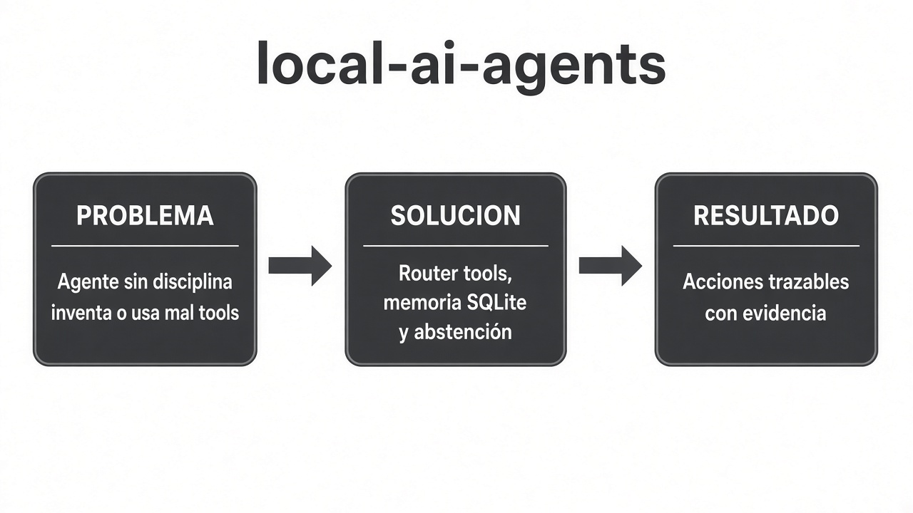
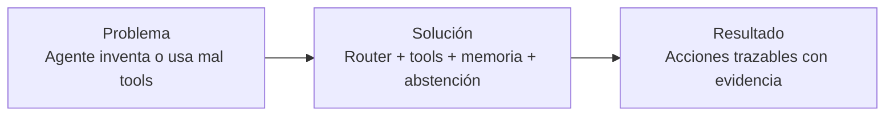

<div align="center">

# local-ai-agents

**Agentes locales con tools** · Angel Salazar

`router → tools → evidencia → respuesta | abstención`

<br/>


</div>

---

### `$ cat diagrama.md`



---

### `$ whoami`

```text
runtime: local · memoria: SQLite
regla: si no hay evidencia, no inventa
tools: list/search/read/summarize/compare/multihop/calc/now
```

---

### `$ ./agent.sh`

```bash
python -m venv .venv
.venv\Scripts\activate
pip install -e .
pytest
python -m local_agents "¿Cuál es el límite comercial?"
python scripts/demo.py
python -m local_agents --repl
```

---

### `$ cat discipline.md`

1. No inventar fuera del corpus  
2. Citar `doc_id` cuando use docs  
3. Abstenerse si el overlap es bajo  
4. Registrar cada turno en SQLite  

---

Hecho en Lima · Angel Salazar · CIP 404730
